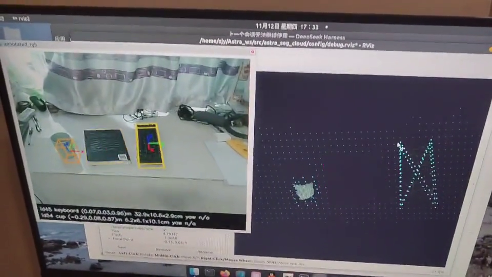

# astra_seg_cloud — RGB-D 实例分割 → 逐实例 6DoF 点云

把 **Orbbec Astra** 的 RGB-D 流变成带跨帧稳定 ID 的**逐实例点云 + 6DoF OBB + 抓取候选**，
并把同一帧的 RGB、点云、标注图落成 rosbag2。面向**桌面抓取**（相机固定、单视角）。

**默认使用通用的 COCO 预训练分割模型**（`yolo26s-seg` / `yolov8s-seg`），不依赖自采数据：
同一套代码换场景只需改 `target_classes`。这是本项目最重要的取舍（见 §2）。



📹 **演示视频**：[docs/media/demo.mp4](docs/media/demo.mp4)（32 s，已去音轨）

---

## 1. 效果（实测，320×240 / 相机 15 fps）

| 指标 | 值 |
|---|---|
| 端到端 | **15 fps / 55–61 ms**（3 个物体，含 RViz 调试点云） |
| 推理 | 22 ms（COCO `yolo26s-seg` ONNX，CUDA EP） |
| 点云阶段 | 33–38 ms（整帧反投影 + 去桌面 + 逐物体认领 + 拟合） |
| 3D 框 | keyboard **31.0×11.6×2.8**（抖动 0.25/0.14/0.01 cm）、book 26.4×20.9×2.7、cup 8.3×8.3×10.7 |
| 出现率 | 三个物体均 **121/121 帧**（不闪、不消失） |
| 节点 CPU | **99%（1 核）** |

---

## 2. 为什么用通用 COCO 模型

同一张桌子上的实测对比：

| 模型 | keyboard | book | remote |
|---|---|---|---|
| **COCO `yolo26s-seg`（默认）** | ✅ 0.83–0.92 | ✅ 0.4–0.6 | ⚠️ 偶发（0.2，5/78 帧） |
| 自训 `yolo26s-seg`（1024，自建数据集） | ❌ 0/95 | ❌ 0/95 | ✅ 0.60（95/95） |

**结论**：自训模型在训练场景里对某类很强，但没见过的类别直接归零；COCO 虽然对白色遥控器这类小物体弱，
但**换物体/换场景不用重新训练**。所以默认走 COCO + 类别白名单；需要补强某一类时，代码里有**副模型挂钩**
（`secondary_model` + `secondary_classes`，只让副模型负责那一类）。

自训工具链也已备齐（`capture_images.py` → `auto_label.py` → `fix_labels.py` → `build_dataset.py`），
注意**必须 `imgsz=320`** 与相机原生一致（我们踩过 1024 训练 / 640 推理的坑，精度直接崩）。

---

## 3. 算法：场景级点云 + 远到近认领

单视角下最麻烦的是"两个物体接触"：近处物体的 mask 会吃进下方物体的表面点，
实测遥控器点云里 **74.7% 是书面点、框歪 45°**。解决思路不是事后修框，而是**从源头分配点**：

```
整帧深度 → 反投影一次（stride 3）→ passthrough(z, h) → 体素
   → RANSAC 去桌面（6 mm；桌面点单独下采样给 RViz，并从场景删除）
   → 检测结果按"mask 内中位深度"降序（远→近）
   → for 每个物体 k:
         mask_k -= 所有"更近"物体的 mask          # 书不会抢走压在它上面的遥控器
         sel    = mask_k ∩ 场景 ∩ 未认领
         true_pts = RANSAC 平面(4 mm) 内的点       # 只保留该物体表面
         场景   -= true_pts                          # 只删这些
         OBB   = 原有多边形 / 圆柱分支（不动）
```

要点：
1. **只删 true_pts**：删整个 mask 会把后面物体的数据删没；
2. **圆柱不能套平面裁剪**：曲面偏离平面，4 mm 会把杯身砍掉（曾只剩 60 点、整帧被跳过）；
3. **桌面判定要带队**：RANSAC 偶尔把"键盘顶面"当桌面，若从场景删掉，键盘整帧消失；
   现在被拒的平面只从**搜索范围**排除，并校验与上一帧桌面法线（≤10°）/ 偏移（≤3 cm）一致；
4. **圆柱 yaw 用规范基**：回转体 yaw 不可观测且有 180° 歧义，用桌面法线 + 固定参考方向，
   footprint 取近似直径的正方形（yaw 标准差 138.8° → **0.22°**）。

---

## 4. 调试记录（问题 → 事实 → 修法）

| # | 现象（实测） | 根因 | 修法 |
|---|---|---|---|
| 1 | 键盘点云横跨 1 m | YOLOv8-seg 的 mask 是 prototype 线性组合，**没按检测框裁剪** | mask 只在框内取 |
| 2 | 单帧 96 ms | `msg.data = bytes` 让 rclpy 逐元素转换 3 万点 | 改 `array.array('B')`（→0.5 ms） |
| 3 | 框外点 16.9% | `fit_obb` 某分支**提前 return**，包点云没执行 | 收敛到 `contain_points()` |
| 4 | 框偶发歪 5.9° | 参数名 `mask` 与内点变量撞名，传入的 mask 从未使用 | 改名 `image_mask` |
| 5 | 杯子框躺倒 85° | 圆柱被 RANSAC 抓到侧壁当主平面 | z 统一用桌面法线 |
| 6 | 桌面法线偶歪 37° | 深度图最大平面偶尔锁到背景 | 朝上先验 + 相邻帧 8° 防跳 |
| 7 | 杯子框顶矮 2 cm | 高度口径从 `z_max−z_min` 改成 `p5~p95`（为一个不存在的 bug） | 回到 `z_max−z_min` |
| 8 | 键盘高 7.4（真实 3.0） | 新链路漏了 `clean_by_plane()` | 补回（4 mm 严格阈值） |
| 9 | 高度算出 73 cm | `fit_obb_on_plane` 的平面偏移传 `-base`，应为 `d_table − base` | 修正偏移 |
| 10 | 场景模式框仍被覆盖 | 第二遍"支撑面"逻辑覆盖新结果 | scene 模式禁用第二遍 |
| 11 | remote 点云 74.7% 是书面点、框歪 45° | mask 在接触处混入下方物体表面点 | 远到近认领 + `mask_k -= mask_更近` |
| 12 | 键盘 71/122 帧消失 | RANSAC 把键盘顶面当桌面，并从场景删掉了这些点 | 被拒平面只排除出搜索范围 + 法线/偏移一致性 |
| 13 | 杯子时隐时现 | 圆柱套了平面裁剪（只剩 60 点），且 `_estimate` 门槛 80 | 圆柱跳过平面裁剪 + 门槛降到 35 |
| 14 | 杯子框乱转（yaw std 138.8°） | 拿圆柱自身拟合轴当规范基（轴每帧在晃），且 ±n 有 180° 歧义 | 改用桌面法线 + 统一朝上 + 方形 footprint（→0.22°） |
| 15 | 帧率 8.7（曾 15） | ONNX Runtime + OpenBLAS 默认按核数(20)开线程并**自旋**，占 1800% CPU | 线程限 1 + 关自旋（→15 fps，CPU 99%） |
| 16 | RViz 一开就崩宿主 | 从 agent shell 启动 Qt 程序，继承环境/会话 | `systemd-run --user --collect` + 干净环境 + `NO_AT_BRIDGE=1` |
| 17 | RViz 里 RGB 面板空白 | RViz 把"显示项被取消勾选"持久化到 `~/.rviz2`，覆盖配置 | 清 `~/.rviz2` 后重启 |

判据教训（已写进代码注释）：
- **"框内点 100%" 是弱指标**，只证明没有点露在框外，不证明框紧；要看 `框尺寸 vs 点云范围` 与真值；
- **不要拿 2D mask 去对齐 3D 框**（把误差藏起来）；
- 3D 框底面近角的投影本来就比接触线低几像素，**那是几何必然**。

---

## 5. 可视化

- **RGB**：3D 框（实例色，1 px）+ 三轴（无箭头）+ 底部字幕（`id / 类别 / 中心 / 尺寸 / yaw`，前面带同色块）；
  字幕**固定 5 行**，物体增减时图像高度不变（否则 RViz 里画面会跳）。
- **调试模式**（`debug_mode: true`）：额外在 RGB 上叠加**实例 mask**（半透明 + 描边）；正常 run 不显示。
- **RViz**：`/astra_seg/debug/{plane,objects,boxes,all}`，框的 12 条棱按 **4 mm** 离散成点、每实例独立颜色。

---

## 6. 快速开始

```bash
colcon build --symlink-install --packages-select astra_seg_interfaces astra_seg_cloud

ros2 launch astra_camera astra_mini.launch.py                  # 相机
ros2 run astra_seg_cloud astra_seg_cloud --ros-args \
  --params-file ~/Astra_ws/src/astra_seg_cloud/config/params.yaml \
  -p target_classes:="['cup','keyboard','book','bottle','remote']" \
  -p scene_pipeline:=true -p record_bag:=false                 # 节点

# RViz（本机必须这样起，否则会崩宿主；见 §4-16）
systemd-run --user --collect --unit=rviz-gui \
  --setenv=DISPLAY=:1 --setenv=XAUTHORITY=$HOME/.Xauthority \
  --setenv=XDG_RUNTIME_DIR=/run/user/1000 \
  --setenv=NO_AT_BRIDGE=1 --setenv=QT_ACCESSIBILITY=0 \
  /bin/bash -lc 'source /opt/ros/humble/setup.bash; source ~/Astra_ws/install/setup.bash; exec rviz2 -d ~/Astra_ws/src/astra_seg_cloud/config/debug.rviz'
```

关键参数：

| 参数 | 默认 | 含义 |
|---|---|---|
| `scene_pipeline` | true | 场景级点云 + 远到近认领 |
| `scene_stride` | 3 | 整帧反投影步长 |
| `plane_clean_thresh` | 0.004 | true_pts 的 RANSAC 平面阈值（4 mm） |
| `conf_thres` / `class_conf` | 0.12 / `['remote:0.08']` | 全局 / 类别专属阈值 |
| `debug_mode` / `draw_mask` | false / true | 调试模式（才叠加 mask） |
| `secondary_model` / `secondary_classes` | '' / — | 副模型只负责指定类别 |
| `caption_lines` | 5 | 字幕固定行数（防图像高度跳变） |

---

## 7. 数据与自训流程（可选）

```bash
python3 scripts/capture_images.py --out ~/grasp_ds/raw --n 300 --interval 0.4
python3 scripts/auto_label.py --images ~/grasp_ds/raw --out ~/grasp_ds/labels \
    --model ~/astra_models/yolo26s-seg.onnx --conf 0.12 \
    --names book,bottle,keyboard,pen,remote,stapler
python3 scripts/fix_labels.py --labels ~/grasp_ds/labels --file img_0012 --set-class 4
python3 scripts/build_dataset.py --images ~/grasp_ds/raw --labels ~/grasp_ds/labels \
    --out ~/grasp_ds/dataset --names book,bottle,keyboard,pen,remote,stapler
yolo segment train model=yolo26s-seg.pt data=~/grasp_ds/dataset/data.yaml imgsz=320 epochs=120 batch=16
```

`--names` 决定标签 id（与模型自身 id 解耦），避免"训练 id 与推理 id 错位"。

---

## 8. 已知限制

- remote 这类小物体在 COCO 下不稳定（0.2 分、偶发），宽度估计偏大 2–3 cm；
- book 尺寸抖动较大（偶发把邻近点算进来）；
- 相机 320×240 是硬上限；深度有效 0.8–1.3 m；反光封面有深度飞点；
- 单视角下完全被遮挡的部分不可见，厚度/朝向靠先验。

## 9. 许可

MIT（见 `LICENSE`）。相机驱动 [orbbec/astra_camera](https://github.com/orbbec/astra_camera) 不包含在本仓库；
分割模型来自 Ultralytics（AGPL-3.0，商用请注意）。
